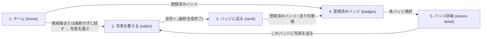

# BG02 Studio 詳細設計書 (Architecture & Implementation Design)

本書は、[`bg02-studio/`](file:///c:/Users/katsu/Documents/Antigravity/BG02/bg02-studio/README.md) に構築する TypeScript 製・マルチリンガル対応 PWA の設計仕様書です。  
実装着手前に確定した方針と、相談・確認したうえで着手する設計詳細を定義します。

---

## 1. 採用技術スタックと構成方針

| 項目 | 選定内容 | 選定理由 |
| :--- | :--- | :--- |
| フォルダ構成 | `bg02-studio/`（独立プロジェクト） | 解析用 `web/` と分離し、単体で GitHub 公開・デプロイしやすくするため |
| ビルド / 言語 | Vite + TypeScript（`strict: true`） | 型安全・高速ビルド・GitHub Pages 向け静的アセット生成 |
| UI 実装方式 | Vanilla TypeScript（フレームワーク無し） | ランタイム依存ゼロでサプライチェーンリスクを最小化し、安全性重視のコンセプトと一致させるため |
| PWA 対応 | Web App Manifest + 軽量自作 `sw.js` | 外部 PWA ランタイム（Workbox 等）を入れず、Vite ビルド時に生成ファイル一覧を自動列挙してオフライン対応するため |
| 単体テスト | Vitest | Vite / TypeScript と設定を共有してプロトコル・JPEG 検証・i18n を高速に型安全テストするため |
| デプロイ先 | GitHub Pages（相対パスベース `./`） | サブディレクトリ公開（`https://<user>.github.io/<repo>/`）でもローカルでもそのまま動作させるため |
| ライセンス | MIT License | 事前合意に基づくオープンソース公開標準ライセンス |
| マルチリンガル | 独自型安全 i18n（初期 `ja` / `en`） | 外部 i18n ライブラリに頼らず、辞書キー抜けをコンパイル時に検出可能にするため |
| ドキュメント | TypeDoc 準拠コメント必須 + 意図コメント + 日英 README | 保守性と研究記録の継承、および GitHub 公開時の海外ユーザー利用を両立するため |

---

## 2. システム全体構成とディレクトリ設計

```text
bg02-studio/
├── LICENSE
├── README.md
├── .gitignore
├── package.json
├── tsconfig.json
├── typedoc.json
├── vite.config.ts             # Vite ビルド + 軽量 sw.js 自動生成 + 本番 CSP 注入プラグイン
├── index.html
├── public/
│   ├── manifest.webmanifest
│   └── icons/
│       ├── icon-192.png
│       └── icon-512.png
├── docs/
│   ├── BACKGROUND.md
│   ├── PROTOCOL.md
│   └── DESIGN.md
└── src/
    ├── main.ts                # エントリポイント・DI・ライフサイクル初期化
    ├── constants/
    │   └── ble.ts             # UUID / チャンク長 / タイムアウト等の定数定義
    ├── ble/
    │   ├── webBluetooth.types.ts # Web Bluetooth API 最小型定義
    │   ├── types.ts           # 端末情報・転送進捗・ログ等の型定義
    │   ├── frameCodec.ts      # 0xCD / 0xDC / WatchTheme3 エンコード・デコード（純粋関数群）
    │   ├── writeQueue.ts      # 20B 分割・優先度付き GATT 送信直列化キュー
    │   └── bg02Client.ts      # Web Bluetooth 接続状態機械・ハンドシェイク・リトライ制御
    ├── imaging/
    │   ├── types.ts           # Transform (x, y, scale, rotation), TextOverlay, OutputResult
    │   ├── jpegInspector.ts   # JPEG SOI / SOF0 / SOF2 解析純粋関数
    │   └── badgeCompositor.ts # 240×240 円形位置合わせ描画 + 任意文字合成 + JPEG 圧縮エンジン
    ├── i18n/
    │   ├── types.ts           # TranslationSchema 型定義
    │   ├── ja.ts              # 日本語辞書
    │   ├── en.ts              # 英語辞書
    │   └── i18n.ts            # 言語検出・localStorage 永続化・イベント通知・補間
    ├── state/
    │   ├── appStore.ts        # 5画面状態・ドラフト世代・不変リトライセッション・ログの単方向ストア
    │   ├── deviceRegistry.ts  # 複数台 BG02 プロファイル・削除済墓石(deletedDeviceIds)・自動再接続設定
    │   ├── offlineStatus.ts   # Service Worker 制御 & スコープ付きキャッシュ実在検証
    │   └── sendSession.ts     # 送信先分離・送信前安全ゲート(evaluateUploadGate)・履歴復元
    ├── ui/
    │   ├── styles.css         # 無地ソリッド面基調・ライト/ダーク両対応 (light-dark() / forced-colors)
    │   ├── icons.ts           # DOM API (`createElementNS`) によるゼロ依存インライン SVG アイコン群
    │   ├── domHelpers.ts      # 安全な DOM 構築 / XSS 回避（textContent 原則・アイコン付きボタン）
    │   ├── badgeStatusHelper.ts # バッジ状態・電池表記（前回取得/未確認）・円形サムネイル共通関数
    │   ├── screenRouter.ts    # 5画面遷移履歴 (History API)・inert隔離・フォーカス復帰制御
    │   ├── homePanel.ts       # 画面1 ホーム（接続、接続状態に応じた編集導線、表示中のバッジの管理）
    │   ├── firstRun.ts        # 起動ロゴの表示時間と、ホームの主操作を指す初回案内
    │   ├── badgeEditor.ts     # 画面2 写真を整える（円形プレビュー・ドラッグ/ピンチ/キー操作・折畳詳細）
    │   ├── sendPanel.ts       # 画面3 バッジに送る（9状態遷移・ネイティブ<progress>・再送復旧）
    │   ├── badgesListPanel.ts # 画面4 登録済みバッジ（一覧・追加・詳細遷移）
    │   ├── deviceDetailPanel.ts # 画面5 バッジ詳細（名前変更・削除確認・解除手順・診断アコーディオン）
    │   └── logPanel.ts        # 通信ログ表示・コピー・クリア機能
    └── __tests__/
        ├── badgeCompositor.test.ts
        ├── bg02Client.test.ts
        ├── deviceRegistry.test.ts
        ├── frameCodec.test.ts
        ├── i18n.test.ts
        ├── jpegInspector.test.ts
        ├── p1SecurityAndRaces.test.ts
        ├── screenRouter.test.ts
        └── writeQueue.test.ts
```

### 5画面遷移と BLE / 送信安全状態機械



- **誤送信・誤完了防止の不変条件**:
  - `WriteQueue.reset()` と `Bg02Client.sessionGeneration` / `connectAttemptSeq` により、切断・再接続・ピッカーキャンセルで旧接続の書き込みや通知が新セッションへ混線しません。
  - `UploadPhase` (`"awaiting_start_ack" | "sending_chunks" | "awaiting_finish_ack"`) により、全チャンク完了・`DIAL_FINISH` 送出前の早期 `code=2` は完了として受け入れません。
  - `evaluateUploadGate()` が `expectedDeviceId` 一致、`algorithm === 4`、寸法、`SOF0`、電池 ≥ 20% を確認したうえで不変コピー `FrozenUploadSession` を確定し、失敗時は同一バイト列で再送します。

### 検証ログ（版別・検証範囲）

| 時期 / 対象 | 実機接続 (`BG02 V35922`) | ブラウザ / API 自動・擬似検証 | 備考 |
| :--- | :--- | :--- | :--- |
| 初期実機解析フェーズ | 実施済み（`240×240`, `algorithm=4`, `slot=5538`, `0x20/0x02`, `0x20/0x04`） | 単体テスト基礎 | BLE プロトコル仕様・95% 停止要因確認 |
| P1/P2 セキュリティ改修 & 5画面再構成・UI/UX 刷新版（現在） | **確認済み**（実機転送成功・実機側での初期プリセット削除も確認） | Vitest（2端末擬似クライアント再現・SWキャッシュ・墓石除外含む）＋ Chromium 模擬端末検証 | `getDevices()` / `forget()` の環境差は Chrome 157 実測仕様＋擬似ドライバで確認 |

---

## 3. 主要モジュール設計

### 3.1 BLE プロトコル層 (`src/ble/`)
- **純粋関数と I/O の分離**:
  - `frameCodec.ts` はブラウザ API に依存しない純粋な `Uint8Array` 変換・パーサーとして実装し、Node / Vitest 等で単体テストしやすくします。
- **`writeQueue.ts` の優先制御**:
  - **設計意図**: 画像転送中に端末から通知フレームが届いた場合、即座に `0xDC` ACK を返さないと端末側が再送やストールを起こします。そのため、`0xDC` ACK の書き込みは通常データキューの先頭（または優先レーン）で差し込み処理を行います。
- **`bg02Client.ts` & `deviceRegistry.ts` のマルチ端末・再接続設計**:
  - Notify 2 系統（`7e400003`, `7e400004`）購読 → `Lqm2.r` ペアリングフレーム送信 → 受信ストリームバッファのフレーム境界再構築。
  - `deviceCache: Map<string, WebBluetoothDevice>` による複数台 `BG02` のハンドル保持、`navigator.bluetooth.getDevices()` 同期、デバイス切替時の旧セッション切断抑止、および意図的切断 (`"manual"`) と予期せぬ切断 (`"unexpected"`) の識別。
  - 予期せぬ切断時は `main.ts` で指数バックオフ（1.2s / 2.5s / 4.5s・最大 3 回、常時キャンセル可能）の自動再接続を実施し、`localStorage` に端末ごとの `device.id`・ニックネーム・カラータグ・最終バッテリー値を保持。
  - `uploadDialImage` における「**書き込みキュー完了後の 15 秒応答タイマー起動**」および最大 3 回のチャンクタイムアウト再送。

### 3.2 円形位置合わせ＆任意文字合成エンジン (`src/imaging/`)
- **設計思想（ユーザー要望の反映）**:
  - 単独の文字列ジェネレータではなく、**「画像を読み込み、円形ディスプレイ（既定 240×240）へ綺麗に配置して送り出す」** 体験を中心に据えます。
  - テキスト合成は **「必要であれば画像の上に文字を載せる」** オプションセクションとして提供します。
- **配置操作 (`ImageTransform`)**:
  - `offsetX`, `offsetY`（中心基準のオフセット px）
  - `scale`（フィット基準倍率からのズーム倍率）
  - `rotationDeg`（-180° 〜 +180° 任意回転 + 90° クイック回転ボタン）
  - `backgroundColor`（透過 PNG や枠余白の塗りつぶし色）
  - **プレビュー表示**: 端末が `round` の場合、プレビュー上では円形クリッピング＋半透明セーフエリアガイドを表示します（実際の JPEG データは矩形 240×240 キャンバスに背景色で描画し、端末側の円形マスクに適合させます）。
  - **インタラクティブ操作**: ポインターイベント（マウスドラッグ / モバイルタッチドラッグ・スライダー調整・リセットボタン・「枠に合わせる (Cover / Contain)」クイックボタン）。
- **任意テキスト合成 (`TextOverlayConfig`)**:
  - `enabled: boolean`（ON/OFF 切替、既定 OFF にして画像中心の UI にする）
  - `text: string`（複数行対応）
  - `fontFamily`, `fontSizePx`, `textColor`, `strokeColor`, `strokeWidth`, `offsetY`（上/中央/下配置等、背景写真の上でも視認性を確保できるよう縁取り対応）
- **JPEG 出力・検証**:
  - 出力サイズ予測と目標容量最適化（例：自動品質探索または品質スライダー + 現在容量のインジケータ表示。15KB 超で警告表示、など）。
  - `inspectJpeg()` で `FF D8` と `SOF0 (FF C0)`・寸法一致・非プログレッシブを送信前チェック。

### 3.3 型安全マルチリンガル機構 (`src/i18n/`)
- `TranslationSchema` インターフェースをマスター型とし、`ja.ts` / `en.ts` に `satisfies TranslationSchema`（または型注釈）を強制します。これにより**翻訳キーの漏れやタイポを TypeScript コンパイルエラーとして即座に検出**できます。
- 初期言語判定: `localStorage` 保存値 → `navigator.languages` / `navigator.language`（`ja*` なら `ja`、それ以外は `en`）→ フォールバック `en`。
- パラメータ補間（例: `"{width}×{height} px"`）をサポート。

---

## 4. コーディング & TypeDoc 厳格規約（必須ルール）

本プロジェクトの全 TypeScript ソースファイル（`src/**/*.ts`）では以下を徹底します：

1. **全シンボルへの TypeDoc 記述**:
   - **すべての `class`, `interface`, `type`, `enum`, `function`, クラスメソッド・プロパティ, トップレベル `const` / `let` 変数**に `/** ... */` 形式の TypeDoc コメントを付与する。
   - `@param`, `@returns`, `@throws` 等を漏れなく記載する。
2. **「なぜ（Why / Intent）」コメントの必須化**:
   - 数値定数（`20` バイト、`6`ms / `10`ms、`15000`ms、`5538`、`0x08` 等）やプロトコル順、タイマー配置場所など、**コードだけを読んでも背景意図が分からない箇所には必ず理由コメントを併記**する。
3. **ドキュメント検証スクリプト**:
   - `npx typedoc` で警告・エラーが出ないこと、および `tsc --noEmit` が通ることを検証ゲートに含める。
4. **セキュリティ衛生**:
   - ユーザー入力文字列は `innerHTML` を使わず必ず `textContent` で描画する。
   - 外部 `fetch()` / CDN スクリプト / Google Analytics 等の外部通信を一切含めない（Service Worker テスト・CSP メタタグでも外部通信禁止を担保する考え方）。

---

## 5. フェーズ 1（初期リリース）スコープと対象外

- **フェーズ 1 に含める（実機検証済み機能のみ）**:
  - BLE 接続 / 再接続 / 切断検知
  - 端末詳細（`0x20/0x02`）・空き容量（`0x20/0x04`）・バッテリー/DIS 読取
  - 円形位置合わせエディタ（移動・ズーム・回転・背景色）＋ 任意テキスト合成
  - Baseline JPEG 生成・サイズ確認・`SOF0` 検証・`WatchTheme3` 転送
  - 日本語 / 英語切り替え・PWA マニフェスト / オフラインキャッシュ / 通信ログ
- **フェーズ 1 対象外（別タスクで [`web/`](file:///c:/Users/katsu/Documents/Antigravity/BG02/web/index.html) にて実機検証後に判断）**:
  - 端末内リスト取得 (`0x20/0x03`)、動画/GIF (`fileType=1` MJPEG-AVI)、時刻同期 (`0x12/0x04`)、端末を探す (`0x12/0x0B`)

---

## 6. 確定済み詳細仕様（相談・合意反映）

| 項目 | 決定仕様 |
| :--- | :--- |
| **PWA Service Worker** | 外部 PWA ランタイム依存を入れず、Vite ビルドプラグイン（`vite.config.ts` 内自作プラグイン）で出力アセット一覧を自動抽出した軽量 `sw.js` を生成する（キャッシュバージョンはビルド時ハッシュ連動・`Cache-First + Network Fallback` / 同一オリジン相対パス動作）。 |
| **JPEG 容量・品質調整** | **「自動最適化（15KB 目標）」トグル（既定 ON）** と **手動品質スライダー（OFF 時またはプレビュー併用）** の切り替え式とし、出力バイト数および目標超過警告をリアルタイム表示する。 |
| **GitHub README 構成** | 日本語メイン [`README.md`](../README.md) と英語版 [`README.en.md`](../README.en.md) の両ファイルを用意する。 |
| **単体テスト基盤** | **Vitest**（開発依存のみ・ランタイム影響ゼロ）を用い、`frameCodec`, `jpegInspector`, `i18n` 等をテストする。 |
| **ライセンス著作権表記** | MIT `LICENSE` / `package.json` に `Katsu Yamazawa`（2026）として反映済み。 |
